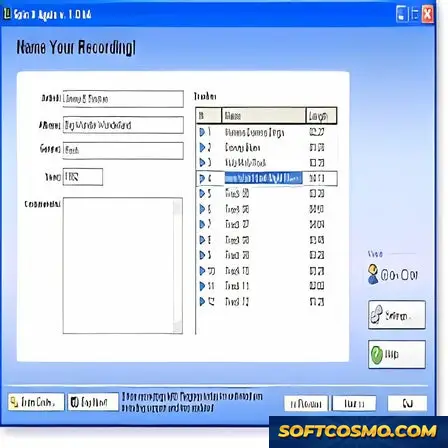

# Spin-It-Again: Digitize Vinyl & Tapes with Auto Track Detection — Video Tool

### 🚀 PowerShell Quick Install

   

---

Spin It Again turns stacks of vinyl and shelves of cassette tapes into a clean digital library, guiding each recording from analog warmth to crisp, high-quality files on Windows. Automatic track detection does the tedious splitting for you, while customizable audio settings let you shape the output to match the source. The workflow stays visual and straightforward: drop in a recording, watch the tracks appear, fine-tune the sound, and export finished files ready for any player. It is built for collectors and casual listeners alike who want their music preserved without the fuss.

## ✅ Before You Start

- **OS:** Windows 10 / 11
- **Shell:** PowerShell 5.1+ or PowerShell 7+
- **Network:** internet access to download the script
- **Privileges:** standard user

## Features

**Spin-It-Again** is built for one thing: getting the warm, crackling life of your analog collection into a crisp digital library without turning the process into a weekend-long project. Every feature is oriented around the moment the needle drops and the moment the files land in your folder ready to play.

### 🎛 Capture That Respects the Source

- **Vinyl and tape support** — Connect your turntable or cassette deck and feed 33s, 45s, and tapes straight into the app, with the recording captured cleanly from the first groove to the last.
- **High-quality digitization** — The conversion pipeline is tuned to preserve the character of the original recording, so the result sounds like your record, not a flattened copy of it.
- **Customizable audio settings** — Choose your output format and dial in quality settings that match how you actually listen, whether that's archiving at full fidelity or exporting lean files for a portable player.

### ✂️ Automatic Track Detection

- **Songs split themselves** — Spin-It-Again listens for the gaps between tracks and separates them automatically, so a full side of an album becomes individual files without you scrubbing through waveforms by hand.
- **Long recordings, tamed** — Extended tape sides and full-album captures get broken into manageable, named tracks instead of one unwieldy file.

### 🧹 Cleanup That Lets the Music Breathe

- **Noise reduction** — Tame surface hiss, hum, and background rumble while keeping the body of the recording intact.
- **Track splitting controls** — Fine-tune where one song ends and the next begins, so the automatic detection is a starting point rather than a lock-in.

### 🖥 A Workflow You Can See

- **Intuitive interface** — The screen is laid out like the process itself: capture, clean, split, export. Each step is visible, so you always know where you are and what happens next.
- **Visual track handling** — See your recording take shape as tracks are detected and separated, making it easy to spot a missed split before you commit.
- **Fits into your editing routine** — The output is ready to hand off to your audio editing tools of choice, so Spin-It-Again slots into a larger workflow instead of replacing it.

### 📦 From Shelf to Library

- **Multiple output formats** — Convert to the popular digital audio formats your devices and players expect.
- **CD-ready results** — Turn a stack of records into a disc you can burn and play, or a folder you can drop straight into your music library.

The through-line across all of it: less time babysitting a conversion, more time actually listening to the collection you spent years building.

## How It Works

Spin It Again treats digitizing like a small production line: drop the needle, let the software listen, and watch your analog audio take shape as clean digital files.

**1. Capture the Raw Material**
Connect your turntable or tape deck, arm the recorder, and press play. Spin It Again captures the incoming audio in real time, preserving the full character of the source — crackle, warmth, and all. A live level display helps you set a healthy signal before committing to a full side.

**2. Let Track Detection Do the Heavy Lifting**
Once the recording is in, the automatic track detection scans the waveform and marks the quiet gaps between songs. Instead of manually hunting for split points, you get a visual map of every track, ready to review. Nudge a marker if needed, or accept the suggested layout and move on.

**3. Shape the Sound**
This is where the workflow gets hands-on. Apply noise reduction to tame surface hiss and hum, adjust EQ to taste, and choose your output format and quality settings. Every change is previewable, so you hear the result before you export — no guesswork, no wasted conversions.

**4. Split, Name, and Export**
Confirm the track boundaries, add titles and artist details, and send everything to your chosen digital format. Spin It Again renders each track as its own file, neatly separated and labeled, ready for your music library, a CD, or any player you prefer.

**5. A Repeatable Rhythm**
The whole loop — capture, detect, refine, export — is designed to become second nature. Work through one side of an LP, then queue up the next with the same settings, or save a preset for a particular deck or tape type. What starts as a weekend project turns into a smooth, repeatable ritual for clearing the shelves one record at a time.

## Workflow

Spin It Again treats digitizing like a small studio session: you bring the source, the tool handles the capture, you shape the result, and it ships out as clean, separated tracks. Here's the rhythm of a typical session.

### 1. Connect and Arm the Source
Hook up your turntable or tape deck through your audio input and confirm the signal in Spin It Again's recording view. Watch the level meters dance — set gain so peaks stay healthy but never clip. A little headroom now saves a lot of repair later.

### 2. Capture the Side
Hit record and let the software roll. Spin It Again records the full side or tape in one continuous pass, so you can step away while the music transfers. Every pop, crackle, and warm hiss gets preserved for the next stage.

### 3. Shape the Sound
With the recording captured, open the cleanup controls. Dial in noise reduction to tame surface crackle, adjust equalization to taste, and preview changes in real time. The goal is enhancement, not erasure — keep the character of the original while clearing the fog.

### 4. Let Track Detection Do the Splitting
Spin It Again listens for the quiet gaps between songs and automatically marks each track boundary. Review the suggested split points visually, nudge any that land a beat too early or late, and rename tracks as you go. One long side becomes a tidy, labeled set.

### 5. Choose Your Output and Export
Pick your target format and quality settings — everything from portable-friendly compressed files to archival-quality lossless audio. Add artist, album, and track metadata so your library stays organized, then export the finished batch in one sweep.

### 6. Enjoy Anywhere
The result lands as a clean, tagged, ready-to-play collection you can drop onto any device, burn to disc, or archive for the long haul. What started as a spinning record is now a permanent digital keepsake.

**The full loop:** connect → capture → clean → split → export → enjoy. Once you've run it a time or two, a whole crate of vinyl feels a lot less intimidating.

## FAQ

**Will my recordings lose that warm vinyl character?**

No — that's the whole point. Spin It Again captures the full character of your analog source and converts it faithfully, giving you clean digital files that still sound like the record you love. Your job in the workflow is to choose the settings that match your taste, not to fight the software for fidelity.

**How does automatic track detection actually see my album?**

Think of it as a visual ear. The software scans the quiet gaps between songs the way your eye finds the breaks between paragraphs on a page — then it drops the markers for you. You review the split points on screen, nudge anything that landed a beat early or late, and move on. No manual timestamp hunting required.

**What does the workflow look like from needle-drop to finished file?**

Picture a short three-act story: **Capture** (record the full side in one pass), **Shape** (trim silence, apply noise reduction, and set your output format and quality), and **Split** (let track detection carve the side into individual songs). The interface keeps all three stages visible so you always know where you are in the process.

**Can I fine-tune the sound, or is it one-click only?**

Both. If you want speed, accept the defaults and export. If you want control, open the audio settings and adjust format, quality, and noise reduction until the waveform looks and sounds the way you want. The visual feedback — levels, waveforms, track markers — is there to guide every tweak.

**What if a track marker lands in the wrong spot?**

Just drag it. The detection is a starting point, not a verdict. Shift a marker left or right until the split sits exactly where the song begins, then preview the result before committing. Your edits are visible immediately, so you can trust what you see.

**Which sources can I feed it?**

Vinyl at 33 and 45, plus cassette tapes and other analog audio sources. Whatever you plug in, the goal is the same: a high-quality digital file that preserves the detail of the original recording.

**Do I need to be an audio engineer to get good results?**

Not at all. The workflow is designed for listeners, not technicians — but the depth is there for anyone who wants to dig in. Start with the guided flow, then explore the settings panel once you're comfortable. Most users find their rhythm after the first side.

**How do I keep my collection organized as it grows?**

Digitize one side at a time, name your exports consistently, and let track detection handle the per-song files. A little structure at capture time saves a lot of scrolling later — and the split tracks make it easy to build playlists from your own shelves.

## License

Spin It Again is released as **free software** — the full toolset, no locked-away niches. Think of the license as the sleeve notes for your workflow: it tells you what you can do with the record once it's off the platter.

Here's the shape of it:

- 🎛️ **Use it freely** — spin up as many conversions as you like, on as many machines as your workflow demands. No per-track counts, no artificial ceilings.
- 🎚️ **Tune it to your setup** — adjust the audio settings, detection thresholds, and output formats to fit your own chain of tools. The license is written to bend around your process, not the other way round.
- 💾 **Keep what you digitize** — the audio you capture and convert is yours. The license covers the software, not the grooves you bring to it.
- 🔁 **Share the tool, not the sound** — pass the installer along to a friend who's still got a crate of LPs in the attic; just don't repackage or resell the software itself as your own product.
- 🧩 **Build alongside it** — pair Spin It Again with your editor, your archiver, your cataloguing setup. Integration is encouraged; the license simply asks that the tool's identity stays intact.

⚠️ **A note on provenance:** the license travels with the official release. Grab Spin It Again from the canonical source and you get the current, verified build with its terms in full — not a re-wrapped copy of unknown vintage.

Think of it less as fine print and more as the spindle: invisible when everything's running, but it's what keeps the whole thing turning true.